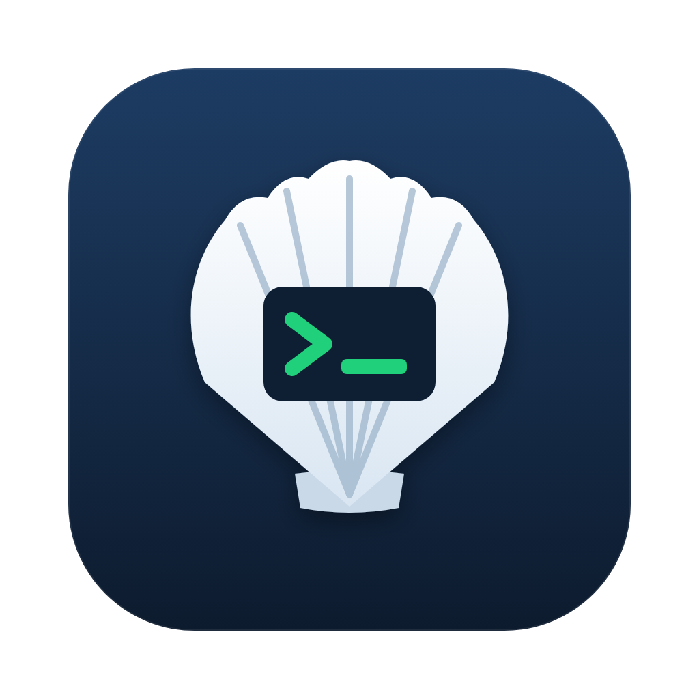

<p align="center">
  
</p>

<h1 align="center">Sshelby</h1>

<p align="center">
  A local-first SSH client for macOS, Windows and Linux.<br>
  Hosts and groups, terminal tabs, SFTP, port forwarding, keys and identities.<br>
  <b>No account, no cloud, no telemetry.</b>
</p>

---

Sshelby is a desktop SSH client inspired by the look and workflow of Termius, with a few ideas
borrowed from MobaXterm. Everything is stored on your machine, with passwords and private keys
encrypted by your operating system's keychain.

## Features

- **Hosts & groups**: nested groups, grid / list / tree views with drag & drop, search, quick
  connect (`user@host:port`), custom icons and colors, OS detection, tags.
- **Credentials**: per-host credentials, reusable **identities** (password, SSH key or SSH agent),
  "use parent credentials" inheritance through groups, saved or prompted passwords.
- **SSH agent**: ssh-agent, KeePassXC's SSH agent, Pageant, Windows OpenSSH agent; pin an identity
  to one key of the agent.
- **Terminal**: xterm.js tabs, 30 color themes (per host or global), find, copy/paste, snippets,
  optional **keyword highlighting** (errors, warnings, IPv4/IPv6, dates…), optional **status bar**
  with the remote CPU, RAM, load and disk usage.
- **SFTP**: dual-pane browser (local or any host on each side), drag & drop, transfers with
  progress, rename, delete, chmod, and a **remote file editor** (or open in your local editor with
  automatic upload on save).
- **Port forwarding**: local, remote and dynamic (SOCKS5) rules, auto-start, live status.
- **Keychain**: generate (Ed25519, ECDSA, RSA) or import SSH keys, copy or install the public key on
  a host.
- **Jump hosts**, **known hosts** with fingerprint verification, **host key change** warnings.
- **Import / export**: `~/.ssh/config`, MobaXterm sessions, and an **encrypted, selective export**
  (AES-256-GCM, scrypt) to move hosts to another machine.

## Install

Download the package for your system from the [releases](https://github.com/croos555/sshelby/releases):

| System | File |
|---|---|
| macOS (Apple Silicon / Intel) | `Sshelby-<version>-arm64.dmg` / `-x64.dmg` |
| Windows | `Sshelby Setup <version>.exe` (installer) or `Sshelby-<version>-portable.exe` |
| Linux | `Sshelby-<version>.AppImage` or `sshelby_<version>_amd64.deb` |

Windows releases are code-signed (Certum); SmartScreen may still warn until the app builds up
reputation. macOS builds are not signed yet: use right-click → *Open* the first time.

## Documentation

- [User guide](docs/user-guide.md)
- [Security model](docs/security.md)
- [Development](docs/development.md)
- [Building & releasing](docs/building.md)
- [Contributing](CONTRIBUTING.md) · [Code of conduct](CODE_OF_CONDUCT.md) · [Security policy](SECURITY.md) · [Changelog](CHANGELOG.md)

## Build from source

```bash
git clone https://github.com/croos555/sshelby.git
cd sshelby
npm install
npm run dev          # run in development mode
npm run dist:mac     # or dist:win / dist:linux
```

Requires Node.js 22.12 or later. See [Building & releasing](docs/building.md) for details.

## License

[MIT](LICENSE) © Christophe Roos

Sshelby is an independent project and is not affiliated with Termius or MobaXterm.
